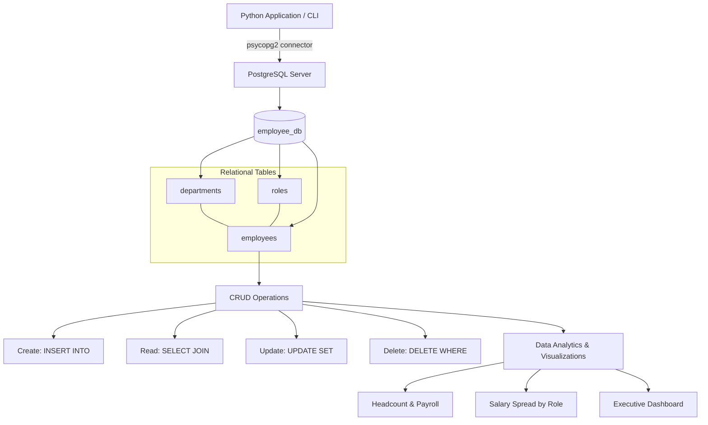
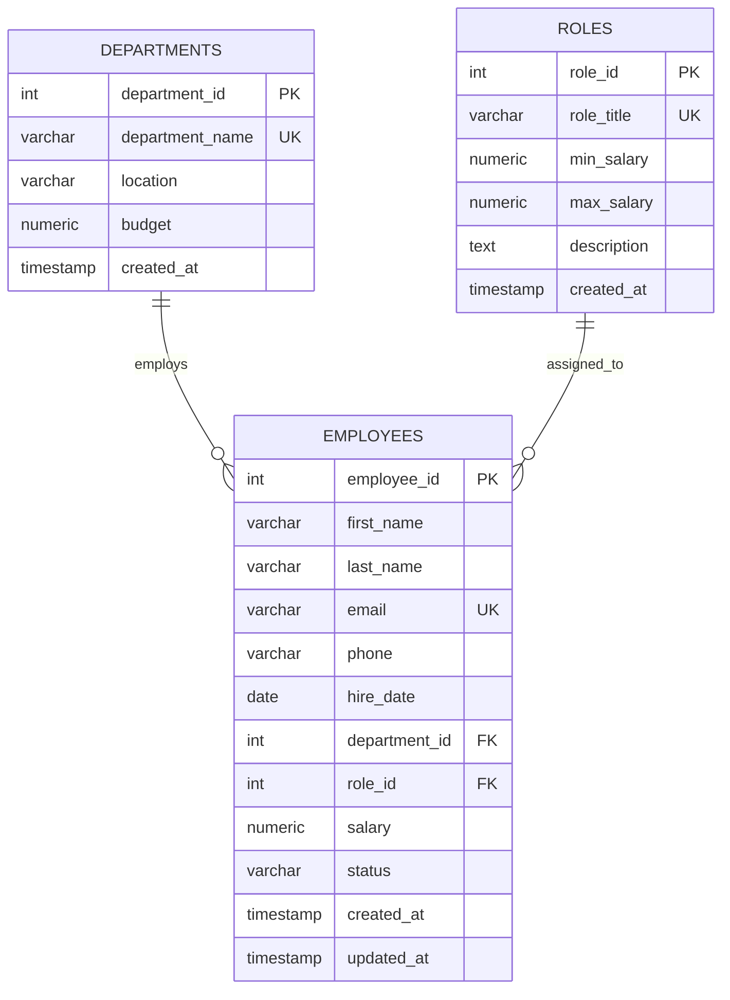

# Experiment / Practical Report 1

## Title
**Development of Python-Based Employee Management System using SQL/PostgreSQL**  
*(Design and Implementation of Employee Data Management System with CRUD Operations using Python and PostgreSQL)*

---

### Aim
To develop a robust, modular Python-based system for managing employee data using an SQL/PostgreSQL relational database. The system performs creation, retrieval, updating, and deletion (CRUD) of employee records while managing departments, job roles, and referential integrity constraints.

### Course Outcomes (CO)
- **CO1:** Understand relational database schemas, connectivity mechanisms, and data retrieval in Python.
- **CO5:** Design, implement, and analyze data management workflows with CRUD operations, SQL joins, aggregations, and data visualization.

---

### Objectives
After performing this experiment, the student is able to:
1. **Understand Python connectivity** with an SQL/PostgreSQL relational database server using `psycopg2`.
2. **Design relational tables** for `departments`, `roles`, and `employees` with primary keys, foreign keys, constraints, and audit timestamps.
3. **Establish and manage database connections** cleanly using Python context managers and transaction handling.
4. **Perform core CRUD (Create, Read, Update, Delete) operations** through programmatic SQL queries.
5. **Retrieve and manage employee information** with multi-table `INNER JOIN` and `LEFT JOIN` aggregations.
6. **Generate analytical reports and data visualizations** using `pandas`, `matplotlib`, and `seaborn`.

---

## 1. Theory & Core Concepts

### 1.1 Relational Database Principles
A relational database stores structured data across normalized tables composed of rows and columns. Relationships between entities are established through:
- **Primary Keys (PK):** Uniquely identify each record (e.g., `department_id`, `role_id`, `employee_id`).
- **Foreign Keys (FK):** Enforce referential integrity by referencing primary keys in parent tables (e.g., `employees.department_id -> departments.department_id`).
- **Constraints:** Guarantee data quality (e.g., `CHECK (budget >= 0)`, `CHECK (max_salary >= min_salary)`, `UNIQUE (email)`).

### 1.2 Entity Architecture
The system organizes organizational data into three interconnected entities:
1. **Department:** Stores organizational business units, locations, and annual budgets.
2. **Role:** Defines job designations, descriptions, and salary brackets (`min_salary` to `max_salary`).
3. **Employee:** Contains employee records, linking each individual to their assigned department and role with salary and employment status.

### 1.3 The CRUD Workflow
- **Create (C):** Insert new records into `departments`, `roles`, or `employees` after validating relational dependencies.
- **Read (R):** Fetch single records, full directory listings, search filters, and multi-table joined views.
- **Update (U):** Modify employee roles, salaries, departments, or statuses while maintaining constraint integrity.
- **Delete (D):** Remove records safely, preventing deletion of departments or roles that currently have assigned employees (`ON DELETE RESTRICT`).

### 1.4 Architecture & System Workflow



---

## 2. Relational Database Schema Design (ER Diagram)



---

## 3. SQL Data Definition Language (DDL)

```sql
-- 1. Departments Table
CREATE TABLE departments (
    department_id SERIAL PRIMARY KEY,
    department_name VARCHAR(100) NOT NULL UNIQUE,
    location VARCHAR(100) NOT NULL,
    budget NUMERIC(12, 2) DEFAULT 0.00 CHECK (budget >= 0),
    created_at TIMESTAMP DEFAULT CURRENT_TIMESTAMP
);

-- 2. Roles Table
CREATE TABLE roles (
    role_id SERIAL PRIMARY KEY,
    role_title VARCHAR(100) NOT NULL UNIQUE,
    min_salary NUMERIC(10, 2) NOT NULL CHECK (min_salary > 0),
    max_salary NUMERIC(10, 2) NOT NULL CHECK (max_salary >= min_salary),
    description TEXT,
    created_at TIMESTAMP DEFAULT CURRENT_TIMESTAMP
);

-- 3. Employees Table
CREATE TABLE employees (
    employee_id SERIAL PRIMARY KEY,
    first_name VARCHAR(50) NOT NULL,
    last_name VARCHAR(50) NOT NULL,
    email VARCHAR(100) NOT NULL UNIQUE,
    phone VARCHAR(20),
    hire_date DATE NOT NULL DEFAULT CURRENT_DATE,
    department_id INT NOT NULL REFERENCES departments(department_id) ON DELETE RESTRICT ON UPDATE CASCADE,
    role_id INT NOT NULL REFERENCES roles(role_id) ON DELETE RESTRICT ON UPDATE CASCADE,
    salary NUMERIC(10, 2) NOT NULL CHECK (salary > 0),
    status VARCHAR(20) DEFAULT 'Active' CHECK (status IN ('Active', 'On Leave', 'Resigned', 'Terminated')),
    created_at TIMESTAMP DEFAULT CURRENT_TIMESTAMP,
    updated_at TIMESTAMP DEFAULT CURRENT_TIMESTAMP
);

-- Indexes for Fast Query Execution
CREATE INDEX idx_employees_dept ON employees(department_id);
CREATE INDEX idx_employees_role ON employees(role_id);
CREATE INDEX idx_employees_email ON employees(email);
```

---

## 4. Python Implementation Details

### 4.1 Project Directory Structure
```
Task_1_Employee_Management_System/
├── config.py                 # DB connection configuration & credentials
├── db_connection.py          # Context-managed connection and query helper
├── schema.sql                # Complete PostgreSQL DDL schema & triggers
├── init_db.py                # Database initialization script
├── seed_data.py              # Automated data seeder with enterprise dataset
├── models/
│   ├── __init__.py           # Package exports
│   ├── department.py         # Department CRUD and payroll aggregations
│   ├── role.py               # Role CRUD and salary band validations
│   └── employee.py           # Employee CRUD, Search, Filter, and JOINs
├── analytics.py              # Executive aggregations & tenure analytics
├── visualizer.py             # Matplotlib & Seaborn chart generation
├── main.py                   # Interactive menu-driven terminal interface
├── run_all_tests.py          # Automated verification test suite (100% pass)
├── requirements.txt          # Python library dependencies
└── visualizations/           # Generated high-resolution chart artifacts
    ├── 1_dept_headcount_and_payroll.png
    ├── 2_salary_distribution_by_role.png
    ├── 3_budget_vs_payroll_comparison.png
    └── 4_executive_dashboard.png
```

---

## 5. Sample Execution & Test Output

### 5.1 Department Aggregation Table (SQL Query + Aggregation)
```
╒═════════════════╤════════════════════╤═════════════════════════════╤══════════════╤═══════════════════╤══════════════╤══════════════╤══════════════╤═════════════════╤══════════════════════════╕
│   department_id │ department_name    │ location                    │       budget │   total_employees │   avg_salary │   min_salary │   max_salary │   total_payroll │   budget_utilization_pct │
╞═════════════════╪════════════════════╪═════════════════════════════╪══════════════╪═══════════════════╪══════════════╪══════════════╪══════════════╪═════════════════╪══════════════════════════╡
│               1 │ Engineering        │ Bengaluru - Tech Hub        │ 2,500,000.00 │                 6 │    89,833.33 │    58,000.00 │   145,000.00 │      539,000.00 │                    21.56 │
│               2 │ Data Science & AI  │ Bengaluru - Innovation Lab  │ 2,200,000.00 │                 5 │   104,400.00 │    50,000.00 │   195,000.00 │      522,000.00 │                    23.73 │
│               3 │ Product Management │ Mumbai - Corporate HQ       │ 1,800,000.00 │                 3 │   124,333.33 │    98,000.00 │   155,000.00 │      373,000.00 │                    20.72 │
│               5 │ Marketing & Growth │ Delhi NCR - Regional Office │ 1,200,000.00 │                 3 │    94,000.00 │    75,000.00 │   115,000.00 │      282,000.00 │                    23.50 │
│               4 │ Human Resources    │ Pune - Operations Center    │   900,000.00 │                 3 │    57,333.33 │    48,000.00 │    72,000.00 │      172,000.00 │                    19.11 │
╘═════════════════╧════════════════════╧═════════════════════════════╧══════════════╧═══════════════════╧══════════════╧══════════════╧══════════════╧═════════════════╧══════════════════════════╛
```

### 5.2 Top Earners in Organization
```
╒═══════════════╤═════════════════╤════════════════════╤══════════════════════════╤════════════╤══════════╕
│   employee_id │ employee_name   │ department_name    │ role_title               │     salary │ status   │
╞═══════════════╪═════════════════╪════════════════════╪══════════════════════════╪════════════╪══════════╡
│             6 │ Dr. Vikram Rao  │ Data Science & AI  │ Lead Data Scientist      │ 195,000.00 │ Active   │
│             7 │ Ananya Patel    │ Data Science & AI  │ Lead Data Scientist      │ 160,000.00 │ Active   │
│            11 │ Neha Gupta      │ Product Management │ Product Manager          │ 155,000.00 │ Active   │
│             1 │ Aarav Sharma    │ Engineering        │ Senior Software Engineer │ 145,000.00 │ Active   │
│            12 │ Karan Singhania │ Product Management │ Product Manager          │ 120,000.00 │ Active   │
╘═══════════════╧═════════════════╧════════════════════╧══════════════════════════╧════════════╧══════════╛
```

### 5.3 Generated Visualizations
The system automatically exports four publication-quality analytics charts into the `visualizations/` folder:
1. `1_dept_headcount_and_payroll.png`: Dual-axis bar chart comparing employee headcount and total monthly payroll across departments.
2. `2_salary_distribution_by_role.png`: Box plot illustrating median salary, interquartile ranges, and individual data points for each job role.
3. `3_budget_vs_payroll_comparison.png`: Grouped comparative bar chart contrasting total allocated department budget against actual monthly payroll expenditure.
4. `4_executive_dashboard.png`: Four-panel master visual analytics dashboard combining headcount distribution, departmental salary dispersion, payroll share breakdown (donut chart), and employee status counts.

---

## 6. How to Run the System

### 6.1 Interactive Terminal CLI
```bash
cd "/home/vishvambar/Desktop/Data Visualisation/Task_1_Employee_Management_System"
python3 main.py
```

### 6.2 Running Automated Verification Test Suite
```bash
python3 run_all_tests.py
```

### 6.3 Re-seeding Sample Database
```bash
python3 seed_data.py
```

### 6.4 Generating Visual Charts
```bash
python3 visualizer.py
```

---

## 7. Learning Outcomes & Conclusion
1. Successfully designed and implemented a normalized relational schema with PostgreSQL (`departments`, `roles`, `employees`).
2. Established secure, resilient Python connectivity via `psycopg2` using connection context managers.
3. Implemented full CRUD functionality with constraint validation, rollback handling, and transaction safety.
4. Leveraged SQL `JOIN`s and aggregation functions (`COUNT`, `AVG`, `SUM`, `MIN`, `MAX`) to generate organizational metrics.
5. Successfully integrated Python Data Visualization libraries (`matplotlib`, `seaborn`, `pandas`) to transform relational database records into executive visual dashboards.
