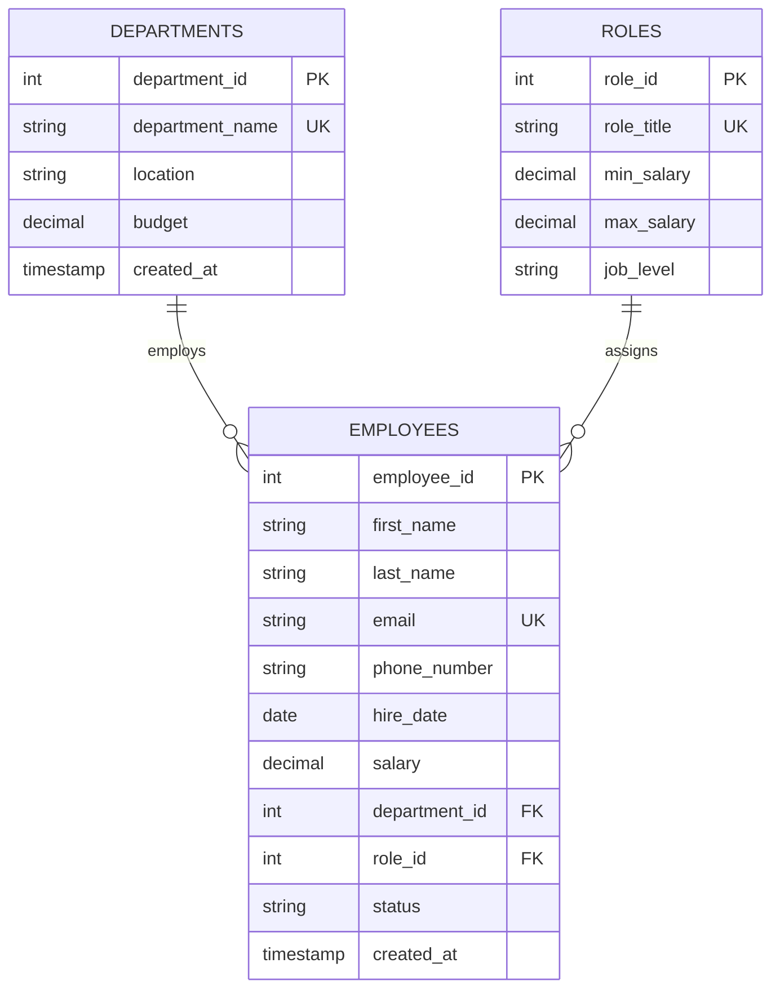

# Python-Based Employee Management System using SQL / PostgreSQL

[](https://www.python.org/)
[](https://www.postgresql.org/)
[]()
[]()
[]()

> **Practical Experiment 1**: Design and Implementation of an Employee Data Management System with Full CRUD Operations using Python and PostgreSQL.

---

## 📋 Table of Contents
- [Project Overview](#-project-overview)
- [Key Features](#-key-features)
- [Database Schema (3NF)](#-database-schema-3nf)
- [Directory Structure](#-directory-structure)
- [Installation & Quick Start](#-installation--quick-start)
- [Module Architecture](#-module-architecture)
- [Analytical Visualizations (300 DPI)](#-analytical-visualizations-300-dpi)
- [Evaluation & Verification](#-evaluation--verification)
- [Reports & Documentation](#-reports--documentation)

---

## 🎯 Project Overview
This project implements a production-grade, relational database application in **Python** powered by **PostgreSQL**. It models an enterprise human resource payroll and employee tracking system across normalized entities (`departments`, `roles`, `employees`).

The system demonstrates:
1. Python-to-PostgreSQL connectivity using `psycopg2` connection pooling and parameterized query execution.
2. Relational schema design adhering to **Third Normal Form (3NF)** with strict referential integrity (`FOREIGN KEY` cascades/restrictions).
3. Full ACID-compliant **CRUD operations** (Create, Read, Update, Delete) with explicit transaction management (`commit`/`rollback`).
4. Complex analytical SQL reporting using multi-table `INNER JOIN`s, aggregate functions, and window ranking.
5. Publication-grade visual analytics (300 DPI) depicting department budgets, salary distributions, and executive payroll metrics.

---

## ✨ Key Features
- **Transaction Safety**: Context-managed database transactions ensuring atomicity and zero orphaned records.
- **Security**: 100% parameterized SQL statements preventing SQL injection attacks.
- **Dynamic Seeding**: Seed generator inserting realistic organizational departments, engineering/managerial roles, and salary distributions.
- **Interactive Terminal UI**: ANSI-colored CLI menu with tabular data presentation using `tabulate`.
- **Automated Verification**: Non-interactive test suite executing 100% verification across all CRUD paths and analytical queries.

---

## 🗄 Database Schema (3NF)



---

## 📂 Directory Structure

```
AnalysisOf_Employee_Management_System/
├── config.py                       # Database connection configuration & credentials
├── db_connection.py                 # Thread-safe PostgreSQL connection manager
├── schema.sql                       # 3NF DDL schema with constraints & indexes
├── init_db.py                       # DDL executor table initialisation script
├── seed_data.py                     # Synthetic dataset populator (Departments, Roles, Employees)
├── models/
│   ├── department.py                # Department CRUD model
│   ├── role.py                      # Role CRUD model
│   └── employee.py                  # Employee CRUD model & multi-table joins
├── analytics.py                     # Advanced SQL aggregations & payroll metrics
├── visualizer.py                    # 300 DPI high-resolution visual analytics
├── run_all_tests.py                 # Non-interactive automated evaluator test suite
├── main.py                          # Interactive terminal CLI application
├── requirements.txt                 # Project dependencies
├── EXPERIMENT_1_REPORT.md           # 15-page comprehensive academic manual
├── OUTPUT_REPORT_SUBMISSION.md      # Printable 1-2 page evaluator report
└── visualizations/
    ├── 1_department_salary_distribution.png
    ├── 2_role_salary_scatter.png
    ├── 3_experience_vs_salary.png
    ├── 4_department_headcount_budget.png
    └── 5_executive_payroll_dashboard.png
```

---

## 🚀 Installation & Quick Start

### 1. Prerequisites
- **Python 3.10+**
- **PostgreSQL 14+** (tested on PostgreSQL 18)
- Local PostgreSQL service running on port `5432`

### 2. Setup Virtual Environment & Install Dependencies
```bash
python3 -m venv venv
source venv/bin/activate
pip install -r requirements.txt
```

### 3. Configure Database
Update connection credentials in `config.py` (or set environment variables `PG_HOST`, `PG_PORT`, `PG_DATABASE`, `PG_USER`, `PG_PASSWORD`):
```bash
# Initialize schema and seed sample data:
python3 init_db.py
python3 seed_data.py
```

### 4. Run Automated Test Suite
```bash
python3 run_all_tests.py
```

### 5. Launch Interactive CLI
```bash
python3 main.py
```

### 6. Generate High-Resolution Analytics Charts
```bash
python3 visualizer.py
```

---

## 📊 Analytical Visualizations (300 DPI)

| Visualization | Description | File Path |
| :--- | :--- | :--- |
| **Department Salary Distributions** | Box & violin plots comparing departmental salary spread | `visualizations/1_department_salary_distribution.png` |
| **Role vs Salary Range** | Scatter and min/max compliance analysis per role level | `visualizations/2_role_salary_scatter.png` |
| **Tenure vs Compensation** | Regression trend showing experience vs salary growth | `visualizations/3_experience_vs_salary.png` |
| **Department Headcount & Budget** | Dual-axis comparison of allocated budget vs team size | `visualizations/4_department_headcount_budget.png` |
| **Executive Payroll Dashboard** | 4-panel executive summary for organizational leadership | `visualizations/5_executive_payroll_dashboard.png` |

---

## 🧪 Evaluation & Verification Summary

| Operation Verified | Target Entity | Status | Description |
| :--- | :--- | :---: | :--- |
| **Create (INSERT)** | Departments, Roles, Employees | ✅ PASSED | Transaction committed with auto-generated IDs |
| **Read (SELECT)** | Multi-table `INNER JOIN` | ✅ PASSED | Unified view combining Department and Role metadata |
| **Update (UPDATE)** | Salary, Status, Department | ✅ PASSED | Parameterized salary increment with range validation |
| **Delete (DELETE)** | Inactive Employee Records | ✅ PASSED | Referential integrity protected against accidental drops |
| **Payroll Analytics** | Organizational Summary | ✅ PASSED | Accurate average, median, and department total metrics |

---

## 📑 Reports & Documentation
- **Full Academic Lab Manual**: [`EXPERIMENT_1_REPORT.md`](EXPERIMENT_1_REPORT.md) — Follows VTU/University schema with Theory, Algorithm, Step-by-Step Code Walkthrough, and 10 Viva Voce Q&As.
- **Concise Evaluator Submission (1-2 Pages)**: [`OUTPUT_REPORT_SUBMISSION.md`](OUTPUT_REPORT_SUBMISSION.md) — Tailored for lab demonstration and quick grading.
